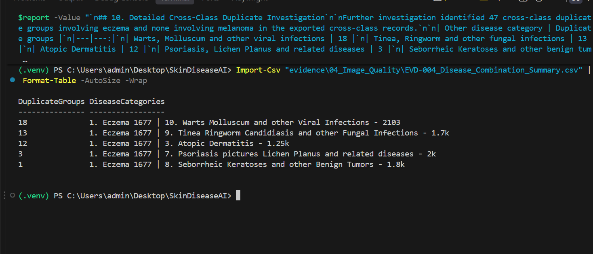

# EVD-004 — Image Quality and Duplicate Analysis

**Project:** SkinDiseaseAI — COMP903  
**Date:** 22 October 2026  
**Status:** Analysis completed; duplicate remediation pending

## 1. Objective

Evaluate the integrity and quality of the skin disease image dataset before preprocessing and training EfficientNetB0 and ResNet50 classification models.

The investigation focuses on image readability, file integrity, image characteristics, exact duplicates and potential label inconsistencies.

## 2. Dataset Information

- Source: Kaggle
- Dataset: ismailpromus/skin-diseases-image-dataset
- Total disease categories: 10
- Total image files: 27,153
- Dataset location: data/IMG_CLASSES/

## 3. Tools and Methodology

The analysis was conducted using Python 3.11, Pillow 13.0.0, hashlib and PowerShell.

The custom Python script `scripts/check_image_quality.py` performed:

1. Image structure verification using Pillow.
2. Full image pixel decoding to identify unreadable files.
3. Extraction of image dimensions, formats and colour modes.
4. SHA-256 hashing to identify byte-identical image files.
5. Identification of duplicate groups across disease categories.
6. Export of reproducible research results to CSV and JSON.

The original dataset was not modified.

## 4. Observed Results

| Measurement | Result |
|---|---:|
| Total image files | 27,153 |
| Successfully decoded images | 27,153 |
| Images failing validation | 0 |
| Exact duplicate groups | 588 |
| Files belonging to duplicate groups | 1,212 |
| Redundant copies beyond one per group | 624 |
| Cross-class duplicate groups | 117 |
| Reported image format | JPEG |

### Image Readability

All 27,153 image files passed the implemented Pillow verification and decoding checks.

No corrupted or unreadable images were identified by this method.

This does not establish that every image is clinically suitable.

### Exact Duplicate Detection

SHA-256 analysis identified 588 groups containing identical image files.

A total of 1,212 files belong to these groups, representing 624 redundant copies if one file per group were retained.

### Cross-Class Duplicate Detection

Further analysis identified 117 exact-duplicate groups containing images assigned to more than one disease category.

This creates a potential risk of conflicting labels and requires investigation before model training.

## 5. Research Implications

### Data Leakage

Identical images must not be placed in separate training, validation and test partitions.

Otherwise, model performance measurements may be artificially inflated.

### Label Consistency

Cross-class duplicates require review to determine whether the associated labels are conflicting, overlapping or otherwise explainable.

### Class Imbalance

Melanoma and eczema contain different image counts.

Class balancing and suitable evaluation metrics will therefore be considered during model development.

## 6. Proposed Corrective Actions

1. Inspect cross-class duplicate groups and their labels.
2. Preserve original dataset files.
3. Record exclusion or relabelling decisions with justification.
4. Use duplicate-aware train/validation/test splitting.
5. Investigate near-duplicates using perceptual image comparison.
6. Check image dimensions and colour modes.
7. Document class balancing and preprocessing settings.
8. Reassess the final dataset before model training.

## 7. Limitations

- SHA-256 detects byte-identical files only.
- Visually similar but differently encoded images may remain.
- Label correctness has not been clinically validated.
- Cross-class duplicates are not automatically confirmed annotation errors.
- No images have been deleted or relabelled.
- Model training and evaluation have not yet been completed.

## 8. Supporting Evidence

- EVD-004_Image_Inventory.csv
- EVD-004_Corrupt_Images.csv
- EVD-004_Exact_Duplicates.csv
- EVD-004_Cross_Class_Duplicates.csv
- EVD-004_Summary.json
- scripts/check_image_quality.py

## 9. Conclusion

The dataset passed the implemented image readability checks, but exact-duplicate and cross-class duplicate analysis identified data-quality issues requiring attention.

These findings provide evidence for the importance of systematic data preparation and leakage prevention before evaluating the proposed CNN models.

**Next research activity:** Cross-class duplicate investigation and preprocessing strategy.

## 10. Detailed Cross-Class Duplicate Investigation

Further investigation identified 47 cross-class duplicate groups involving eczema and none involving melanoma in the exported cross-class records.

| Other disease category | Duplicate groups |
|---|---:|
| Warts, Molluscum and other viral infections | 18 |
| Tinea, Ringworm and other fungal infections | 13 |
| Atopic Dermatitis | 12 |
| Psoriasis, Lichen Planus and related diseases | 3 |
| Seborrheic Keratoses and other benign tumours | 1 |
| **Total** | **47** |

These findings indicate potential label inconsistencies, not clinically confirmed annotation errors. Eczema and atopic dermatitis may overlap in clinical terminology. Original images remain unchanged, and label review is required before training.

Supporting evidence: EVD-004_Melanoma_Eczema_Duplicates.csv and EVD-004_Disease_Combination_Summary.csv.

## 11. Visual Evidence

The following screenshot records the observed cross-class disease-category combinations and their duplicate-group counts.

