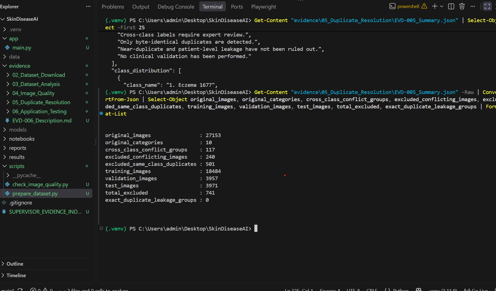

# EVD-005 — Duplicate Resolution and Dataset Splitting

**Project:** SkinDiseaseAI — COMP903 Research Project  
**Date:** 22 October 2026  
**Status:** Preprocessing completed; further leakage checks pending

## 1. Objective

Prepare the skin disease image dataset for comparative deep learning experiments while minimising exact-duplicate data leakage and preserving the original images.

## 2. Dataset Summary

The original dataset contains 27,153 images across 10 skin disease categories.

Image quality analysis identified 588 exact-duplicate groups, including 117 groups containing images assigned to different disease categories.

Cross-class duplicate groups were excluded from training because their labels require expert review.

Within the remaining same-class duplicate groups, one representative image was retained and redundant copies were excluded.

## 3. Duplicate Resolution Results

| Measure | Result |
|---|---:|
| Original images | 27,153 |
| Disease categories | 10 |
| Cross-class conflict groups | 117 |
| Images excluded due to conflicting labels | 240 |
| Redundant same-class duplicates excluded | 501 |
| Total excluded images | 741 |
| Exact-duplicate leakage groups across splits | 0 |

No original images were modified or deleted.

## 4. Dataset Splitting Results

A reproducible random seed of 42 was used to create approximately 70% training, 15% validation and 15% testing partitions within each category.

| Partition | Image count |
|---|---:|
| Training | 18,484 |
| Validation | 3,957 |
| Testing | 3,971 |
| Excluded | 741 |
| Total original images | 27,153 |

The final eligible dataset contains 26,412 images.

## 5. Verification

The preprocessing script completed successfully and reported:

**RESULT: PASS — No exact-duplicate leakage**

## 6. Generated Evidence Files

- [Dataset Manifest](EVD-005_Dataset_Manifest.csv)
- [Class Split Summary](EVD-005_Class_Splits.csv)
- [Preprocessing Summary](EVD-005_Summary.json)
- [Verification Screenshot](EVD-005_Dataset_Split_Verification.png)

## 7. Research Limitations

- SHA-256 comparison detects byte-identical files only.
- Visually similar images stored with different encodings may remain.
- Patient-level independence cannot be established without reliable patient identifiers.
- Conflicting disease labels have been excluded, not medically corrected.
- Dataset label quality and external generalisability have not been clinically validated.

Therefore, the dataset is verified against exact-duplicate leakage, but it is not yet proven free of all forms of data leakage.

## 8. Conclusion

The preprocessing workflow produced reproducible, class-stratified partitions while excluding conflicting labels and redundant exact duplicates.

The resulting data manifests are ready for subsequent review and initial research model experiments using EfficientNetB0 and ResNet50.

**Research disclaimer:** SkinDiseaseAI is an experimental research system and must not be used for clinical diagnosis.
