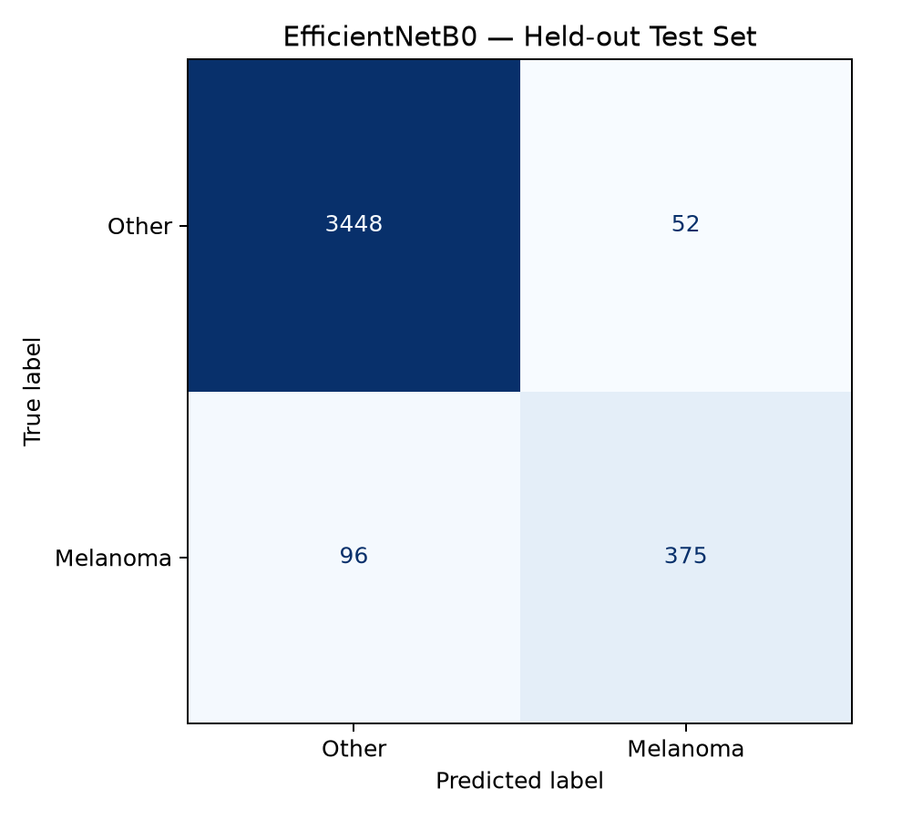

# EVD-007 — EfficientNetB0 Model Evaluation

**Evaluation date:** 26 October 2026

## Objective
Evaluate the trained EfficientNetB0 melanoma-versus-other-classes research classifier using the designated test split.

## Dataset
- Test images: 3,971
- Melanoma images: 471
- Other-class images: 3,500
- Exact SHA-256 overlaps across accepted splits: 0
- Classification threshold: 0.50

## Evaluation Results
| Metric | Result |
|---|---:|
| Accuracy | 96.27% |
| Precision (melanoma) | 87.82% |
| Recall / Sensitivity (melanoma) | 79.62% |
| Specificity | 98.51% |
| F1-score | 83.52% |
| ROC-AUC | 0.9838 |
| Average precision | 92.30% |

## Confusion Matrix
| Actual / Predicted | Other classes | Melanoma |
|---|---:|---:|
| Other classes | 3448 | 52 |
| Melanoma | 96 | 375 |

## Evidence Files
- [Metrics](metrics.json)
- [Classification report](classification_report.txt)
- [Individual predictions](predictions.csv)

## Research Limitations
These are measured results on the designated test split. It has not yet been independently verified that this same split was excluded from the original Colab training and model selection. Exact-duplicate separation does not exclude near-duplicate or patient-level leakage. The classifier is not clinically validated, and the scores must not be used for medical diagnosis.

## Conclusion
The EfficientNetB0 evaluation pipeline executed successfully for all 3,971 designated test images and generated reproducible result artifacts. Of 471 melanoma-labelled images, 375 were correctly classified and 96 were missed at the 0.50 threshold.
